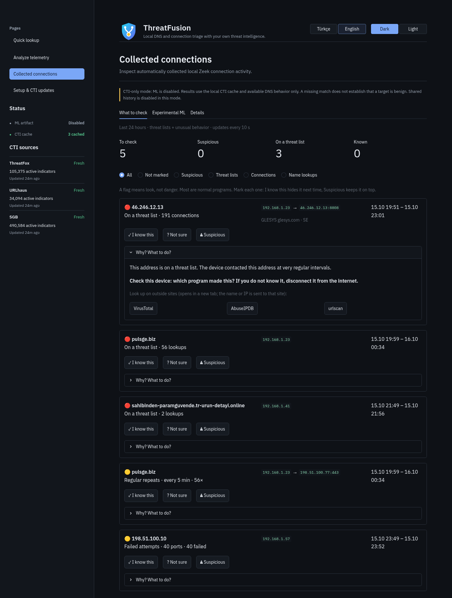
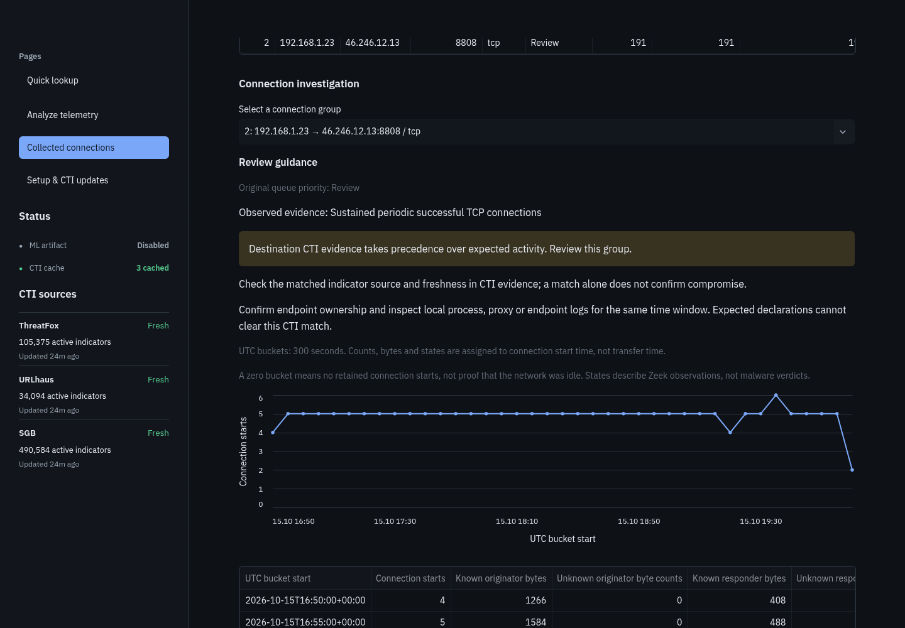
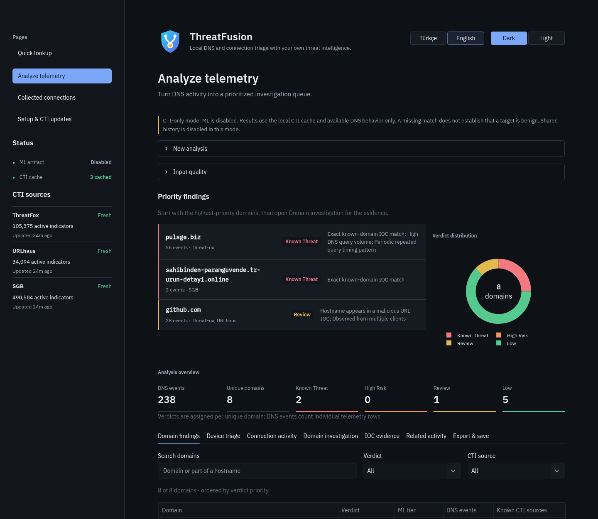
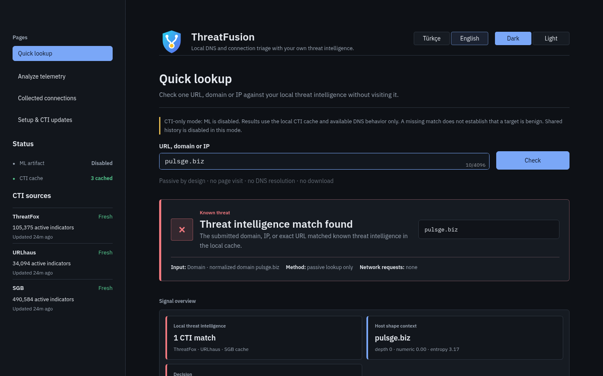
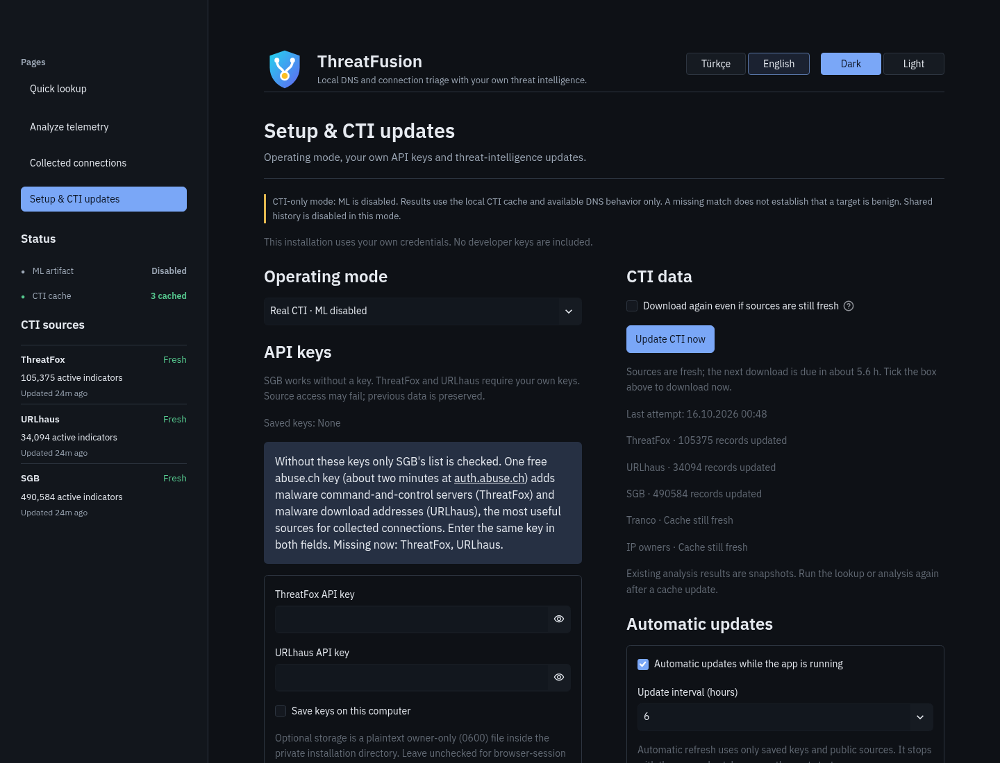

<div align="center">


# ThreatFusion AI

### Local network investigation for Zeek users

<p>
  <strong>English</strong>
  &nbsp;•&nbsp;
  <a href="README.tr.md"><strong>Türkçe</strong></a>
</p>

<p>
  
  
  
  
  
  
</p>

</div>

ThreatFusion reads your **Zeek** network logs, checks every destination against
**threat-intelligence (CTI) lists** and flags connections that **behave like
malware checking in**, and it tells you the reason for every flag. It runs on
your own Linux machine; your traffic never leaves it.

> **Status: early prototype.** The full workflow works: install, CTI updates,
> continuous Zeek collection, a plain review list and investigation. The first
> 24-hour test on real traffic flagged far too much; those defects were fixed
> and a **7-day test on real traffic** is under way (restarted after a
> collector defect it found was fixed). How well it
> catches real malware has **not** been measured yet. It is not a SIEM, EDR,
> IDS or malware scanner.

## What it does

It answers one question: **which device talked to which destination, and which
of those conversations deserve a closer look?**

1. **Collect.** A small collector imports each completed Zeek `conn.log` and
   `dns.log` and keeps the last 24 hours.
2. **Check.** Every destination is compared with SGB, ThreatFox and URLhaus, and
   every device → destination group is checked for suspicious behavior.
3. **Explain.** **What to check** lists only what deserves a look, threat-list
   matches first, each with its reason, the device, the destination's network
   owner and one-click marks: *I know this*, *Not sure*, *Suspicious*.

| Check | Flags a group when | Typical cause |
| --- | --- | --- |
| CTI match | The destination (domain or IP) is on a CTI list | Known malicious server |
| Long session | One two-way TCP session lasts at least 1 hour | Kept-open control channel, or a chat/notification app |
| Regular repetition | 20+ connections over 30+ minutes at very regular intervals | Malware check-ins, or an updater |
| Failed attempts | 20+ different ports/hosts, or 30+ repeated failures, within 5 minutes | Scanning, or a program retrying an unreachable server |

DNS lookups get their own checks (CTI matches, regular queries, unusual volume).
Popular sites and local names stay out of the list unless a CTI list matches.
Normal software can still match these rules; every item shows its evidence so
you can decide quickly. Details: [user guide](docs/USER_GUIDE.md#what-gets-flagged).

## Screenshots

The screenshots come from an isolated copy of the app fed with **crafted Zeek
logs**. The flagged names and IP are real, public indicators from the
ThreatFox and SGB lists (an AsyncRAT command server, a RemusStealer
command domain and a phishing domain); no traffic was sent to them, and the
addresses the malicious names resolve to in the logs are reserved documentation
addresses.

<p align="center">
  
</p>
<p align="center"><em>Collected connections → What to check: threat-list matches first, then behavior. Each item says why it is listed and what to do.</em></p>

<p align="center">
  
</p>
<p align="center"><em>Investigating a group: a device checking in with a listed command server every minute, over three hours.</em></p>

<p align="center">
  
</p>
<p align="center"><em>Analyze telemetry: upload one file (here a Zeek dns.log) for a one-time analysis.</em></p>

<table>
<tr>
<td width="50%"><br><em>Quick lookup: check one URL, domain or IP without visiting it.</em></td>
<td width="50%"><br><em>Setup: your own API keys, CTI updates and automatic refresh.</em></td>
</tr>
</table>

## Install (Linux, one command)

**Needs:** Linux on x86_64 (tested on fresh Debian 12 and Ubuntu 24.04 that have
no Python or Git), an internet connection and about 2 GB of free space. No
sudo. Windows and macOS are not supported.

Open a terminal and paste this one line as your normal user:

```bash
u=https://raw.githubusercontent.com/ConquestorYa/threatfusion-ai/main/scripts/install_linux.sh; f=/tmp/threatfusion-install.sh; { command -v curl >/dev/null && curl -fsSLo "$f" "$u" || wget -qO "$f" "$u"; } && bash "$f"
```

It downloads a private Python 3.12 and checksum-verified libraries into
`~/.local/share/threatfusion-ai`, adds the `threatfusion-ai` command and an
applications-menu entry, and opens the app at http://127.0.0.1:8501 (only this
computer can reach it). The first install takes a few minutes.

| To… | Run |
| --- | --- |
| Open the app again | `threatfusion-ai` (or **ThreatFusion AI** in the applications menu) |
| Stop it | `threatfusion-ai stop` |
| Update to the latest version | stop it, then run the install line again (data and settings are kept) |
| Try it with synthetic data | `threatfusion-ai --mode demo` |
| Uninstall (also deletes saved keys, the CTI cache, collected data and marks; [details](docs/INSTALL_LINUX.md#uninstall)) | `threatfusion-ai stop; rm -rf ~/.local/share/threatfusion-ai ~/.local/bin/threatfusion-ai ~/.local/share/applications/io.github.ConquestorYa.ThreatFusionAI.desktop` |

If a terminal says `threatfusion-ai: command not found`, open a new terminal.

## First steps

**1. Add CTI.** The app opens on **Setup & CTI updates**. SGB works without a
key. One free key from [auth.abuse.ch](https://auth.abuse.ch/) enables both
ThreatFox and URLhaus. Click **Update CTI now**. **Quick lookup** and
**Analyze telemetry** (upload one Zeek, DNS, PCAP or similar file) work from
here on, without Zeek.

**2. Run Zeek** so that it writes rotated `conn.log` and `dns.log` files:
[Zeek sensor setup](docs/ZEEK_SETUP.md) (a pinned Docker recipe; Docker needs
administrator rights once).

**3. Start the collector** in a second terminal and open **Collected connections**:

```bash
threatfusion-ai collect --input-dir ~/zeek-sensor/logs
```

After 3 days of collected traffic the **Experimental ML** tab trains its
behavior model on this computer. More in [Linux installation](docs/INSTALL_LINUX.md).

## Also in the app

- **Quick lookup:** check one URL, domain or IP against your CTI cache. No page
  visit, no DNS lookup, no download. Optional: a domain's registration age and
  an IP's network owner.
- **Analyze telemetry:** upload a single file (Zeek, DNS CSV/Excel, PCAP,
  Suricata EVE, Pi-hole, AdGuard Home, dnstop) for a one-time analysis.
- **Desktop notification** when the collector sees traffic to a threat-list match.
- **Demo mode** (`threatfusion-ai --mode demo`): synthetic data to try the
  interface. Its results are not measurements.

### Experimental machine learning

The **Experimental ML** tab of Collected connections shows **New for this
computer**: destinations your devices never used before that they keep calling
at a steady rhythm, the way a program that "calls home" does. ThreatFusion
learns which destinations are normal for your machine (3 days, only while the
app runs; the memory never leaves the computer). In development tests it listed
about 0.5 entries per normal device per day. It is a reason to look, not a
malware verdict; its binding test is the 7-day run.

The same tab runs a **behavior model trained on your computer**: a random forest
that looks at *how* each device talks to each destination (rhythm, sizes,
durations, failures, port, how random the name looks). The installer ships
numeric features of public malware and normal recordings (Stratosphere Lab,
Malware-Traffic-Analysis.net); after 3 days of your own traffic the app trains
the forest locally in a few seconds and retrains daily. Nothing leaves the
computer. Tested once on recordings it never saw, the recipe caught 5 of 7
malware families on an unseen device and 56 % of unseen malware recordings, with
at most one false flag per day on a real laptop; it caught only 27 % of
2025–2026 malware and 20 % of simulated beacons. The **Model evaluation** page
shows every test. A flag is a reason to look, not a verdict. Models trained on
public recordings alone and the older lexical domain-name score failed and are
off. Full history: [ML evaluation](docs/evidence/ML_DATASET.md).

## Privacy

- Zeek is configured to log connection and DNS metadata only; no page addresses,
  passwords or contents. DNS names still reveal which sites you visit: keep logs
  private.
- Logs, collector state, the CTI cache, the learned destination memory and keys
  stay in private folders on your machine. Nothing is uploaded. Downloads use
  aliases (`Host 1`) by default.
- Suspicious destinations are never visited or resolved. Outside lookup buttons
  (VirusTotal, AbuseIPDB, urlscan) send a name or IP only when you click.
- You use your own API keys; none are bundled.

## Evidence so far

| Measured | Result |
| --- | --- |
| Synthetic normal and simulated traffic | Normal updaters and polling also enter Review: the rules are not yet selective enough ([review workload](docs/evidence/REVIEW_WORKLOAD.md)) |
| Four independent IoT-23 captures (2018–2019) | 0 reviews in two benign captures; one of two malicious captures produced one review, the other none ([network evaluation](docs/evidence/NETWORK_EVALUATION.md)) |
| Fault matrix, 6-hour soak, security reviews | 9/9 fault cases pass; the 6-hour soak passed 16/16 checks (collector peak 684 MiB); two security reviews ([operational confidence](docs/evidence/OPERATIONAL_CONFIDENCE.md)) |
| One laptop, 24 h of normal real traffic | 59 groups for review, all benign; only 3 decidable from the screen alone. Fixed: names on connections, popular-site and local-name context, a plain review list ([results](docs/evidence/REAL_TRAFFIC_EVALUATION.md#arm-a-first-24-hours-results)) |
| First 7-day run on campus Wi-Fi | Failed collector health: other devices' local discovery chatter filled the window. Fixed (collector filter + Zeek capture filter) and restarted ([status](docs/evidence/REAL_TRAFFIC_EVALUATION.md)) |
| Machine learning | Behavior model trained on each computer: 71 % of malware families on an unseen device, 56 % of unseen malware recordings, ≤ 1 false flag per day; weak on 2025–2026 malware (27 %). Public-only and lexical models failed. "New for this computer" passed its development burden check ([ML evaluation](docs/evidence/ML_DATASET.md)) |
| **In progress / not yet measured** | 7-day false alarms on real traffic (in progress), detection of labeled real malware, usefulness for other users |

All records: [documentation](docs/README.md#evidence).

## Related tools

[RITA](https://github.com/activecm/rita) finds beaconing and long connections in
Zeek logs and is the baseline ThreatFusion is compared against.
[Security Onion](https://securityonion.net/) and [Malcolm](https://github.com/cisagov/Malcolm)
are complete monitoring platforms; [Suricata](https://suricata.io/) detects known
attack signatures. ThreatFusion aims to be smaller: one local app that combines
CTI (including Türkiye's SGB list) with explainable behavior checks. Whether it
is more useful than these tools has not been measured.

## Documentation

[User guide](docs/USER_GUIDE.md) · [Zeek setup](docs/ZEEK_SETUP.md) ·
[Installation](docs/INSTALL_LINUX.md) · [Architecture](docs/ARCHITECTURE.md) ·
[Data sources](docs/DATA_SOURCES.md) · [Security](SECURITY.md) ·
[Evidence](docs/README.md#evidence) · [Product plan](docs/dev/PRODUCT_PLAN.md)

## Development

Python 3.12, Streamlit, SQLite, pandas, Altair, Plotly and scikit-learn.
CI runs lint, tests, a privacy audit of the repository, a container check and
first-run installs on fresh Debian and Ubuntu. Linux only.

This project is developed with extensive AI assistance (design, code, tests and
documentation); changes are reviewed and tested before they are merged.

## License

MIT. CTI feeds and datasets keep their own terms; see
[data sources](docs/DATA_SOURCES.md).
