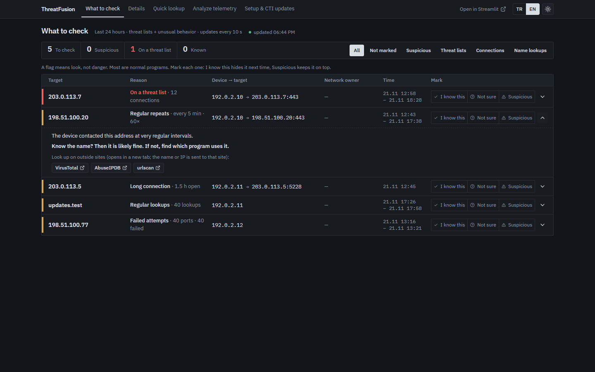

# ThreatFusion AI

**English** · [Türkçe](README.tr.md)

A small tool that runs on my own computer, reads Zeek network logs and tries to
answer "which device talked to what, and which of those should I look at?".
I'm a cybersecurity associate-degree student; this repo is my working notes and
experiments while learning the SOC side.

> **Status:** early prototype. Install, CTI updates, continuous Zeek collection
> and the review list work. I have **not** measured how well it catches real
> malware. It is not a SIEM, IDS or antivirus.

## Why I built it

I want to work as a SOC L1 analyst. I kept reading about beaconing, IOC
matching and false positives but had nothing to see them on. So I recorded my
own network with Zeek to see these ideas in real data. I also wanted one place
that uses Türkiye's national CERT list (SGB) together with ThreatFox and URLhaus.

## How it works

1. **Zeek** listens to traffic and writes `conn.log` and `dns.log`.
2. A **collector** imports finished log files and keeps the last 24 hours in SQLite.
3. Every destination (domain/IP) is checked against **CTI lists**: SGB, ThreatFox, URLhaus.
4. Every `device → destination` group goes through a few simple **behavior rules**.
5. The UI shows a **What to check** list with the reason for each row, and I
   mark it *I know this / Not sure / Suspicious*.

| Rule | Flags when | Why I look |
| --- | --- | --- |
| CTI match | Destination is on a list | Possibly a known malicious server |
| Long session | One TCP session ≥ 1 hour | Could be a C2 channel (chat apps do this too) |
| Regular repetition | 20+ connections over 30+ minutes at very regular intervals (score ≥ 0.85) | Malware beaconing; updaters do it too |
| Failed attempts | 20+ different ports/hosts or 30+ repeated failures in 5 minutes | Scanning, or a program retrying a dead server |

The regularity score is a formula inspired by RITA's beacon score (`rhythm.py`).
There is also **Quick lookup** (check one URL/domain/IP against CTI without
visiting it) and **Analyze telemetry** (upload one log file).

## What I tried and what happened

- **24 h of real traffic on my laptop:** 59 groups flagged, all benign; only 3
  decidable from the screen. Too many false positives. I added domain names to
  connections, separated popular sites and local names and simplified the list.
  ([record](docs/evidence/REAL_TRAFFIC_EVALUATION.md))
- **Collecting on campus Wi-Fi:** other devices' local discovery traffic (mDNS,
  SSDP, NetBIOS…) filled the window. I filtered it out in the collector and in
  Zeek's capture filter.
- **4 IoT-23 captures:** no flags in the two benign ones; one of the two
  malicious ones produced 1 flag, the other none.
  ([record](docs/evidence/NETWORK_EVALUATION.md))

So: it runs, but I can't show it detects well yet. Measuring that is next.

## What I learned

- Zeek `conn.log` fields (`uid`, `id.orig_h`, `id.resp_h`, `conn_state`) and what they mean.
- "Regular interval" alone is not enough for beaconing; updaters and push services are regular too.
- A CTI match is a strong signal; behavior rules only mean "worth a look".
- How tiring false positives are for an analyst.

## Where I got stuck

- The rules also catch normal software; I still don't know how to pick thresholds well.
- Getting labeled, recent malicious traffic to test with is hard.
- Noise from other devices on a campus network surprised me.

## AI use

I used AI assistants heavily while building this: most of the code, tests and
docs were written that way. My part was the idea, running it on my own network
and judging the results.

## Experimental parts

- **Machine learning:** a random-forest behavior model in its own tab. It never
  changes the review list. Results are mixed: [ML evaluation](docs/evidence/ML_DATASET.md).
- **React UI:** the move from Streamlit to React + FastAPI is half done; the
  installer still opens Streamlit.

## To do

- [ ] Measure detection on real, labeled malicious traffic
- [ ] Re-measure false positives on real traffic after the fixes
- [ ] Compare with RITA on the same data
- [ ] Replay an attack in my own VM lab and see what the tool shows

## Install (Linux)

Linux x86_64 (tried on Debian 12 and Ubuntu 24.04), no sudo, about 2 GB free.

```bash
u=https://raw.githubusercontent.com/ConquestorYa/threatfusion-ai/main/scripts/install_linux.sh; f=/tmp/threatfusion-install.sh; { command -v curl >/dev/null && curl -fsSLo "$f" "$u" || wget -qO "$f" "$u"; } && bash "$f"
```

- `threatfusion-ai` opens the app (http://127.0.0.1:8501, this computer only).
- `threatfusion-ai --mode demo` runs it with synthetic data.
- `threatfusion-ai collect --input-dir ~/zeek-sensor/logs` starts collecting Zeek logs.
- `threatfusion-ai stop` stops it.

ThreatFox and URLhaus need a free key from [auth.abuse.ch](https://auth.abuse.ch/);
SGB needs none. Zeek setup: [ZEEK_SETUP.md](docs/ZEEK_SETUP.md). Uninstall and
details: [INSTALL_LINUX.md](docs/INSTALL_LINUX.md).



## Privacy

Everything stays local; nothing is uploaded. Zeek logs connection and DNS
metadata only, but DNS names still show which sites you visit, so keep logs
private. The tool never visits or resolves suspicious addresses.

## Similar tools

[RITA](https://github.com/activecm/rita) (finds beaconing in Zeek; my comparison
baseline), [Security Onion](https://securityonion.net/),
[Malcolm](https://github.com/cisagov/Malcolm), [Suricata](https://suricata.io/).
These are mature tools; mine is a learning project.

## License

MIT. CTI feeds and datasets keep their own terms: [DATA_SOURCES.md](docs/DATA_SOURCES.md).
