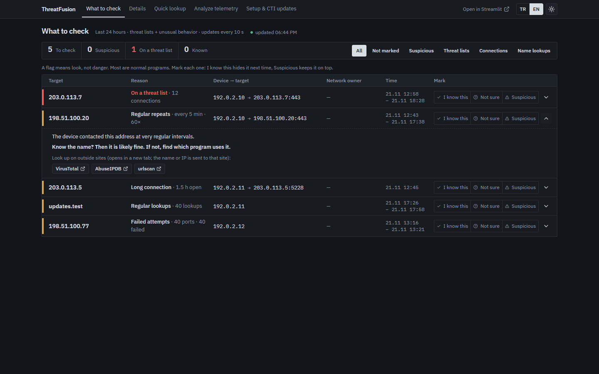

# ThreatFusion AI

[English](README.md) · **Türkçe**

Zeek ağ kayıtlarını okuyup "bu cihaz kiminle konuştu, hangisine bakmam lazım?"
sorusuna cevap vermeye çalışan, kendi bilgisayarımda çalışan küçük bir inceleme
aracı. Siber güvenlik önlisans öğrencisiyim; bu proje SOC tarafını öğrenmek için
yaptığım çalışma notlarım ve denemelerim.

> **Durum:** erken prototip. Kurulum, CTI güncelleme, Zeek'ten sürekli kayıt
> toplama ve inceleme listesi çalışıyor. Gerçek zararlı yazılımı ne kadar
> yakaladığını **henüz ölçmedim.** SIEM, IDS ya da antivirüs değil.

## Neden yaptım

SOC L1 olarak çalışmak istiyorum. Ders anlatımında "beaconing", "IOC
eşleştirme", "false positive" gibi kavramları okuyordum ama elimde bunları
görebileceğim bir şey yoktu. Kendi ağımdaki trafiği Zeek ile kaydedip bu
kavramları gerçek veride görmek istedim.

Bir de Siber Güvenlik Başkanlığı'nın (SGB) zararlı adres listesini ThreatFox ve URLhaus ile
aynı yerde kullanan basit bir araç bulamadım, onu denemek istedim.

## Nasıl çalışıyor

1. **Zeek** ağ trafiğini dinleyip `conn.log` ve `dns.log` dosyaları yazıyor.
2. Bir **toplayıcı (collector)** biten log dosyalarını alıp son 24 saati
   SQLite'ta tutuyor.
3. Her hedef (alan adı / IP) **CTI listeleriyle** karşılaştırılıyor:
   SGB, ThreatFox, URLhaus.
4. Her `cihaz → hedef` grubu birkaç basit **davranış kuralından** geçiyor.
5. Arayüzde **Bakılacaklar** listesi çıkıyor. Her satırda neden listelendiği
   yazıyor; ben de *Tanıyorum / Emin değilim / Şüpheli* diye işaretliyorum.

Kurallar (eşikler kodda sabit, `src/threatfusion/connections.py` ve
`connection_attempts.py`):

| Kural | Ne zaman işaretliyor | Neden bakıyorum |
| --- | --- | --- |
| CTI eşleşmesi | Hedef bir listede var | Bilinen zararlı sunucu olabilir |
| Uzun oturum | Tek TCP oturumu ≥ 1 saat | Açık tutulan C2 kanalı olabilir (ama sohbet uygulamaları da böyle) |
| Düzenli tekrar | 30+ dakikada 20+ bağlantı, aralıklar çok düzenli (skor ≥ 0.85) | Zararlının "eve haber vermesi" (beaconing). Güncelleyiciler de yapıyor |
| Başarısız denemeler | 5 dakikada 20+ farklı port/host ya da 30+ tekrar eden hata | Tarama olabilir ya da ulaşamadığı sunucuyu deneyen bir program |

Düzenlilik skoru RITA'nın beacon skorundan esinlenen bir formül: bağlantılar
arası sürelerin ve boyutların ne kadar düzenli olduğuna bakıyor (`rhythm.py`).

Ayrıca **Hızlı sorgu** (tek bir URL/alan adı/IP'yi siteye gitmeden CTI'da arama)
ve **Telemetri analizi** (tek bir log dosyası yükleyip bakma) var.

## Denediklerim ve sonuçları

- **Kendi laptopumda 24 saat gerçek trafik:** 59 grup listelendi, hepsi zararsızdı.
  Sadece 3 tanesine ekrana bakarak karar verebildim. Yani kurallar çok fazla
  false positive üretiyordu. Bağlantılara alan adlarını ekledim, popüler
  siteleri ve yerel adları ayırdım, listeyi sadeleştirdim.
  ([kayıt](docs/evidence/REAL_TRAFFIC_EVALUATION.md))
- **Kampüs Wi-Fi'ında toplama:** diğer cihazların yerel keşif trafiği (mDNS,
  SSDP, NetBIOS vb.) pencereyi doldurdu, toplayıcı sağlıksız göründü. Bu
  trafiği hem toplayıcıda hem Zeek'in yakalama filtresinde dışarıda bıraktım.
- **IoT-23 veri setinden 4 kayıt:** iki temiz kayıtta hiç işaret çıkmadı; iki
  zararlı kayıttan birinde 1 işaret çıktı, diğerinde hiç çıkmadı.
  ([kayıt](docs/evidence/NETWORK_EVALUATION.md))

Kısacası: araç çalışıyor ama iyi tespit ettiğini gösteremiyorum. Bunu
ölçmek bir sonraki adım.

## Ne öğrendim

- Zeek `conn.log` alanları: `uid`, `id.orig_h`, `id.resp_h`, `conn_state`
  (`S0`, `SF`, `REJ`...) ve bunların ne anlama geldiği.
- Beaconing'i sadece "düzenli aralık" diye aramak yetmiyor; güncelleyiciler,
  bildirim servisleri de düzenli. Bağlam (alan adı, ağ sahibi) olmadan karar
  vermek zor.
- CTI listesi eşleşmesi tek başına güçlü bir sinyal, davranış kuralları ise
  sadece "bakmaya değer" demek.
- False positive'in analist için ne kadar yorucu olduğunu 24 saatlik testte
  bizzat gördüm.

## Takıldığım yerler

- Kurallar normal yazılımı da yakalıyor; eşik değerlerini nasıl seçeceğimi hâlâ
  tam bilmiyorum.
- Gerçek zararlı trafikle test etmek zor: etiketli, güncel veri bulmak kolay değil.
- Kampüs ağında başka cihazların gürültüsü beklemediğim bir sorundu.

## Yapay zekâ kullanımı

Bu projeyi yazarken yapay zekâdan (Claude, ChatGPT vb.) çok yardım aldım:
kodun, testlerin ve dokümantasyonun büyük kısmı bu şekilde yazıldı. Ben fikri,
Zeek kurulumunu, testleri kendi ağımda çalıştırmayı ve sonuçları
değerlendirmeyi yaptım.

## Deneysel kısımlar

- **Makine öğrenmesi:** ayrı bir sekmede random forest tabanlı bir davranış
  modeli var. İnceleme listesini değiştirmiyor. Sonuçları karışık; detaylar
  [ML değerlendirmesi](docs/evidence/ML_DATASET.md) dosyasında.
- **React arayüzü:** Streamlit'ten React + FastAPI'ye geçiş yarım. Kurulum
  hâlâ Streamlit arayüzünü açıyor.

## Yapılacaklar

- [ ] Gerçek, etiketli zararlı trafikle tespit oranını ölçmek
- [ ] Düzeltmelerden sonra gerçek trafikte false positive sayısını tekrar ölçmek
- [ ] RITA ile aynı veride karşılaştırmak
- [ ] Bir saldırı senaryosunu kendi lab ortamımda (VM) oynatıp aracın ne gördüğüne bakmak

## Kurulum (Linux)

Linux x86_64 gerekli (Debian 12 ve Ubuntu 24.04'te denedim). sudo istemiyor,
yaklaşık 2 GB yer lazım. Windows/macOS desteklenmiyor.

```bash
u=https://raw.githubusercontent.com/ConquestorYa/threatfusion-ai/main/scripts/install_linux.sh; f=/tmp/threatfusion-install.sh; { command -v curl >/dev/null && curl -fsSLo "$f" "$u" || wget -qO "$f" "$u"; } && bash "$f"
```

Sonra:

- `threatfusion-ai` uygulamayı açar (http://127.0.0.1:8501, sadece bu bilgisayardan erişilir).
- `threatfusion-ai --mode demo` sahte verilerle dener.
- `threatfusion-ai collect --input-dir ~/zeek-sensor/logs` Zeek loglarını toplamaya başlar.
- `threatfusion-ai stop` durdurur.

ThreatFox ve URLhaus için [auth.abuse.ch](https://auth.abuse.ch/)'den ücretsiz
anahtar gerekiyor; SGB anahtarsız çalışıyor. Zeek kurulumu:
[ZEEK_SETUP.tr.md](docs/ZEEK_SETUP.tr.md). Kaldırma ve detaylar:
[INSTALL_LINUX.tr.md](docs/INSTALL_LINUX.tr.md).



## Gizlilik

Her şey yerelde kalıyor, hiçbir şey yüklenmiyor. Zeek sadece bağlantı ve DNS
bilgisini kaydediyor, içerik yok; ama DNS adları hangi sitelere girdiğini
gösterdiği için loglar gizli tutulmalı. Şüpheli adreslere araç kendisi gitmiyor.

## Benzer araçlar

[RITA](https://github.com/activecm/rita) (Zeek'te beaconing bulur, kendimi
onunla karşılaştırıyorum), [Security Onion](https://securityonion.net/),
[Malcolm](https://github.com/cisagov/Malcolm), [Suricata](https://suricata.io/).
Bunlar çok daha olgun araçlar; benimki öğrenme projesi.

## Lisans

MIT. CTI listeleri ve veri setleri kendi lisanslarına tabi:
[DATA_SOURCES.tr.md](docs/DATA_SOURCES.tr.md).
