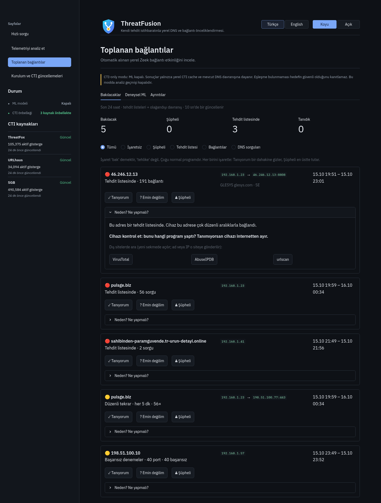
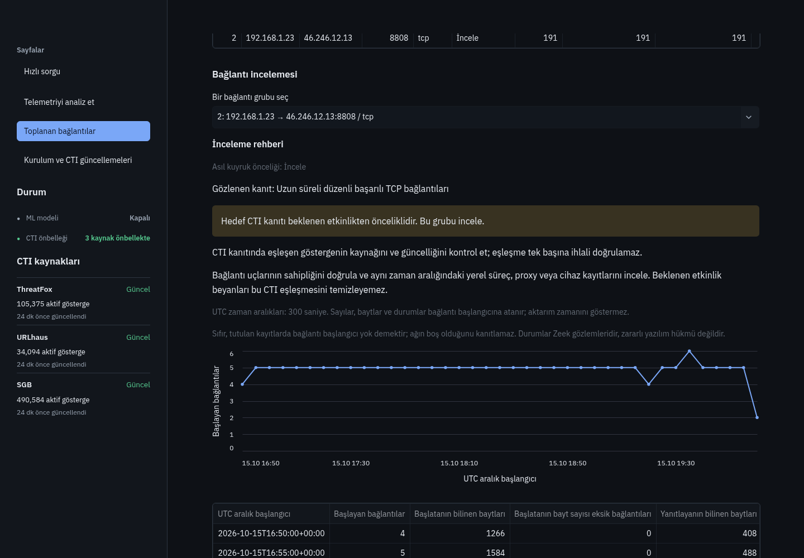
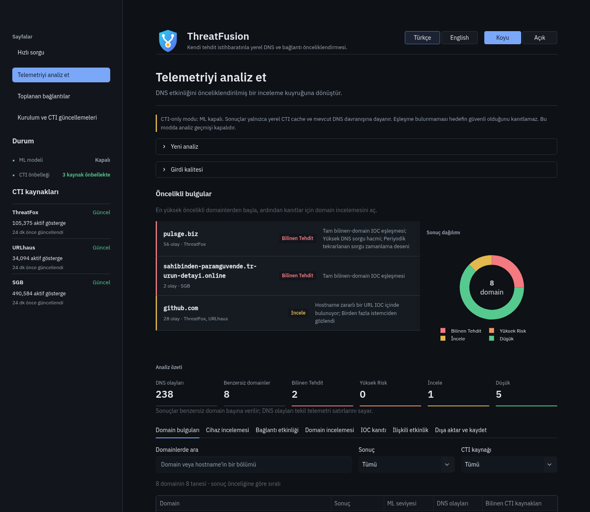
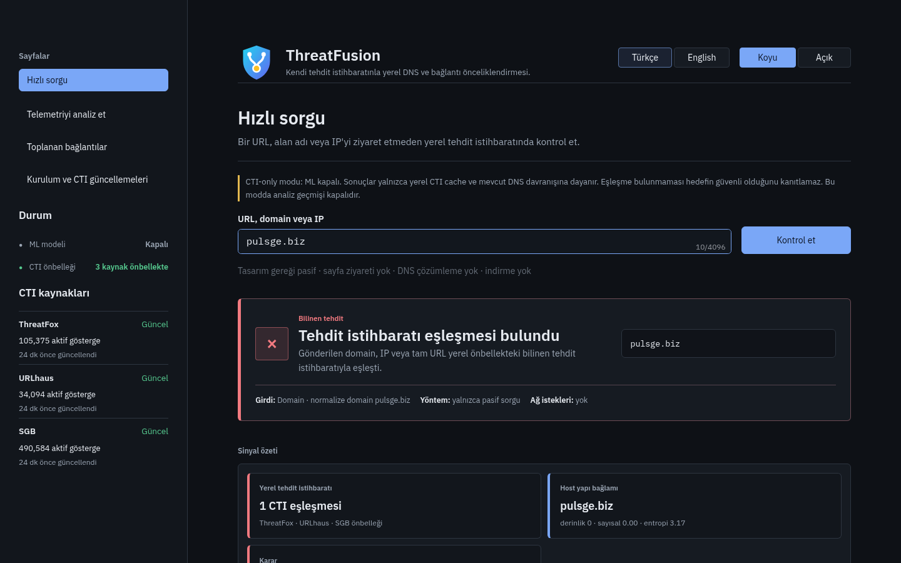
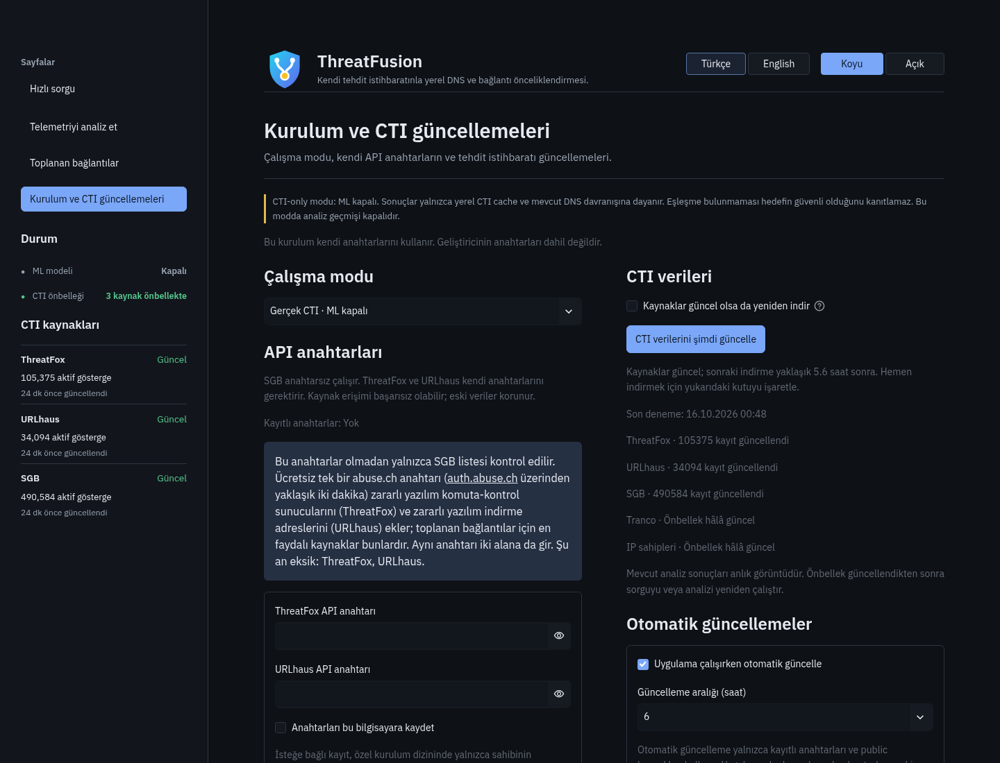

<div align="center">


# ThreatFusion AI

### Zeek kullanıcıları için yerel ağ inceleme aracı

<p>
  <a href="README.md"><strong>English</strong></a>
  &nbsp;•&nbsp;
  <strong>Türkçe</strong>
</p>

<p>
  
  
  
  
  
  
</p>

</div>

ThreatFusion, **Zeek** ağ kayıtlarını okur; her hedefi **tehdit istihbaratı
(CTI) listeleriyle** karşılaştırır ve **zararlı yazılımın "eve haber
vermesine" benzeyen** bağlantıları işaretler. Her işaretin nedenini de söyler.
Kendi Linux bilgisayarında çalışır; trafiğin bilgisayarından dışarı çıkmaz.

> **Durum: erken prototip.** İş akışının tamamı çalışıyor: kurulum, CTI
> güncellemeleri, sürekli Zeek toplama, sade bir inceleme listesi ve inceleme
> ekranları. Gerçek trafikle yapılan ilk 24 saatlik test çok fazla işaret
> üretti; bu kusurlar düzeltildi ve **gerçek trafikle 7 günlük test** sürüyor (bulduğu bir
> toplayıcı hatası düzeltildikten sonra yeniden başlatıldı). Gerçek zararlı yazılımı ne kadar yakaladığı **henüz
> ölçülmedi.** SIEM, EDR, IDS ya da virüs tarayıcı değildir.

## Ne yapar

Tek bir soruyu cevaplar: **Hangi cihaz hangi hedefle konuştu ve bunlardan
hangilerine daha yakından bakmak gerekir?**

1. **Toplar.** Küçük bir toplayıcı (collector), tamamlanmış her Zeek `conn.log`
   ve `dns.log` dosyasını alır ve son 24 saati saklar.
2. **Kontrol eder.** Her hedef SGB, ThreatFox ve URLhaus listeleriyle
   karşılaştırılır; her cihaz → hedef grubu şüpheli davranış açısından incelenir.
3. **Açıklar.** **Bakılacaklar** listesi yalnızca bakmaya değer olanları
   gösterir; tehdit listesi eşleşmeleri en üsttedir. Her madde nedenini, cihazı,
   hedefin ağ sahibini ve tek tıkla işaretleri içerir: *Tanıyorum*, *Emin
   değilim*, *Şüpheli*.

| Kontrol | Bir grubu şu durumda işaretler | Tipik neden |
| --- | --- | --- |
| CTI eşleşmesi | Hedef (alan adı ya da IP) bir CTI listesinde | Bilinen zararlı sunucu |
| Uzun oturum | Tek bir iki yönlü TCP oturumu en az 1 saat sürüyor | Açık tutulan bir kontrol kanalı ya da sohbet/bildirim uygulaması |
| Düzenli tekrar | 30+ dakikada, çok düzenli aralıklarla 20+ bağlantı | Zararlı yazılımın düzenli "haber vermesi" ya da bir güncelleyici |
| Başarısız denemeler | 5 dakika içinde 20+ farklı port/sunucuya ya da 30+ kez tekrarlanan cevapsız/reddedilen deneme | Tarama ya da ulaşılamayan bir sunucuyu deneyip duran bir program |

DNS sorguları için ayrı kontroller vardır (CTI eşleşmesi, düzenli sorgular,
olağandışı hacim). Popüler siteler ve yerel adlar, bir CTI listesi eşleşmedikçe
listeye girmez. Normal yazılımlar yine de bu kurallara uyabilir; her madde
kanıtını gösterir, böylece hızlı karar verebilirsin.
Ayrıntılar: [kullanım kılavuzu](docs/USER_GUIDE.tr.md#neler-işaretlenir).

## Ekran görüntüleri

Görüntüler, uygulamanın **elle hazırlanmış Zeek kayıtlarıyla** beslenen
yalıtılmış bir kopyasından alındı. İşaretlenen adlar ve IP gerçektir:
ThreatFox ve SGB listelerindeki herkese açık göstergelerdir (bir AsyncRAT
komuta sunucusu, bir RemusStealer komuta alan adı ve bir oltalama alan adı).
Bunlara hiçbir trafik gönderilmedi; zararlı adların kayıtlarda çözüldüğü
adresler, belgeler için ayrılmış adreslerdir.

<p align="center">
  
</p>
<p align="center"><em>Toplanan bağlantılar → Bakılacaklar: önce tehdit listesi eşleşmeleri, sonra davranış. Her madde neden listede olduğunu ve ne yapılacağını söyler.</em></p>

<p align="center">
  
</p>
<p align="center"><em>Bir grubu incelemek: listedeki bir komuta sunucusuna üç saat boyunca dakikada bir bağlanan bir cihaz.</em></p>

<p align="center">
  
</p>
<p align="center"><em>Telemetriyi analiz et: tek seferlik analiz için bir dosya yükle (burada bir Zeek dns.log).</em></p>

<table>
<tr>
<td width="50%"><br><em>Hızlı sorgu: tek bir URL, alan adı ya da IP'yi ziyaret etmeden kontrol et.</em></td>
<td width="50%"><br><em>Kurulum: kendi API anahtarların, CTI güncellemeleri ve otomatik yenileme.</em></td>
</tr>
</table>

## Kurulum (Linux, tek komut)

**Gerekenler:** x86_64 Linux (Python ya da Git olmayan sıfır Debian 12 ve
Ubuntu 24.04'te test edildi), internet bağlantısı ve yaklaşık 2 GB boş alan.
Sudo gerekmez. Windows ve macOS desteklenmez.

Bir terminal aç ve bu tek satırı normal kullanıcınla yapıştır:

```bash
u=https://raw.githubusercontent.com/ConquestorYa/threatfusion-ai/main/scripts/install_linux.sh; f=/tmp/threatfusion-install.sh; { command -v curl >/dev/null && curl -fsSLo "$f" "$u" || wget -qO "$f" "$u"; } && bash "$f"
```

Komut, `~/.local/share/threatfusion-ai` içine özel bir Python 3.12 ve
sağlama toplamı doğrulanmış kütüphaneler indirir, `threatfusion-ai` komutunu ve
uygulamalar menüsü kısayolunu ekler ve uygulamayı http://127.0.0.1:8501
adresinde açar (yalnızca bu bilgisayardan erişilebilir). İlk kurulum birkaç
dakika sürer.

| Ne için | Komut |
| --- | --- |
| Uygulamayı yeniden aç | `threatfusion-ai` (ya da uygulamalar menüsünde **ThreatFusion AI**) |
| Durdur | `threatfusion-ai stop` |
| En son sürüme güncelle | durdur, sonra kurulum satırını yeniden çalıştır (veriler ve ayarlar korunur) |
| Sentetik veriyle dene | `threatfusion-ai --mode demo` |
| Kaldır (kayıtlı anahtarlar, CTI önbelleği, toplanan veri ve işaretler de silinir; [ayrıntılar](docs/INSTALL_LINUX.tr.md#kaldırma)) | `threatfusion-ai stop; rm -rf ~/.local/share/threatfusion-ai ~/.local/bin/threatfusion-ai ~/.local/share/applications/io.github.ConquestorYa.ThreatFusionAI.desktop` |

Terminal `threatfusion-ai: command not found` derse yeni bir terminal aç.

## İlk adımlar

**1. CTI ekle.** Uygulama **Kurulum ve CTI güncellemeleri** sayfasıyla açılır.
SGB anahtar istemez. [auth.abuse.ch](https://auth.abuse.ch/) üzerinden alınan
tek bir ücretsiz anahtar hem ThreatFox'u hem URLhaus'u açar. **CTI verilerini
şimdi güncelle**'ye bas. **Hızlı sorgu** ve **Telemetri analizi** (tek bir Zeek,
DNS, PCAP ya da benzeri dosya yükle) bundan sonra Zeek olmadan da çalışır.

**2. Zeek'i çalıştır;** saatlik bölünmüş `conn.log` ve `dns.log` dosyaları
yazsın: [Zeek sensör kurulumu](docs/ZEEK_SETUP.tr.md) (sürümü sabitlenmiş bir
Docker tarifi; Docker bir kez yönetici yetkisi ister).

**3. Toplayıcıyı başlat;** ikinci bir terminalde çalıştır ve **Toplanan
bağlantılar** sayfasını aç:

```bash
threatfusion-ai collect --input-dir ~/zeek-sensor/logs
```

Toplanan trafiğin 3 günü dolunca **Deneysel ML** sekmesi davranış modelini bu
bilgisayarda eğitir. Ayrıntılar: [Linux kurulumu](docs/INSTALL_LINUX.tr.md).

## Uygulamadaki diğer araçlar

- **Hızlı sorgu:** Tek bir URL, alan adı ya da IP'yi CTI önbelleğinde ara.
  Sayfa açılmaz, DNS sorgusu yapılmaz, hiçbir şey indirilmez. İsteğe bağlı:
  alan adının kayıt yaşı ve IP'nin ağ sahibi.
- **Telemetriyi analiz et:** Tek seferlik analiz için bir dosya yükle (Zeek,
  DNS CSV/Excel, PCAP, Suricata EVE, Pi-hole, AdGuard Home, dnstop).
- **Masaüstü bildirimi:** Toplayıcı tehdit listesindeki bir hedefe giden trafik
  görünce bildirir.
- **Demo modu** (`threatfusion-ai --mode demo`): Arayüzü denemek için sentetik
  veri. Sonuçları ölçüm değildir.

### Deneysel makine öğrenmesi

Toplanan bağlantılar sayfasındaki **Deneysel ML** sekmesi **Bu bilgisayar için
yeni** listesini gösterir: cihazlarının daha önce hiç kullanmadığı ve düzenli bir
ritimle aramaya devam ettiği hedefler; "eve telefon eden" bir program böyle
davranır. ThreatFusion bilgisayarın için hangi hedeflerin normal olduğunu öğrenir
(3 gün, yalnızca uygulama açıkken; bu hafıza bilgisayardan çıkmaz). Geliştirme
testlerinde normal bir cihazda günde yaklaşık 0,5 kayıt listeledi. Bakmak için
bir sebeptir, zararlı yazılım kararı değildir; asıl sınavı 7 günlük testtir.

Aynı sekmede **bilgisayarında eğitilen bir davranış modeli** çalışır: her
cihazın her hedefle *nasıl* konuştuğuna bakan bir rastgele orman (ritim, boyut,
süre, başarısız denemeler, port, adın ne kadar rastgele göründüğü). Kurulum,
herkese açık zararlı ve normal kayıtlarının (Stratosphere Lab,
Malware-Traffic-Analysis.net) sayısal özelliklerini getirir; kendi trafiğinin 3
günü toplanınca uygulama ormanı birkaç saniyede bu bilgisayarda eğitir ve her
gün yeniden eğitir. Hiçbir şey bilgisayardan çıkmaz. Tarif, hiç görmediği
kayıtlarda bir kez test edildi: görmediği bir cihazda 7 zararlı ailesinin 5'ini
ve görülmemiş zararlı kayıtlarının %56'sını yakaladı, gerçek bir laptopta günde
en fazla bir yanlış alarm verdi; 2025–2026 zararlılarının yalnızca %27'sini ve
sanal sinyallerin %20'sini yakaladı. **Model değerlendirme** sayfası bütün
testleri gösterir. İşaret bakmak için bir sebeptir, karar değildir. Yalnızca
herkese açık kayıtlarla eğitilen modeller ve eski alan adı puanı başarısız oldu
ve kapalı. Tüm geçmiş: [ML değerlendirmesi](docs/evidence/ML_DATASET.md)
(İngilizce).

## Gizlilik

- Zeek yalnızca bağlantı ve DNS üst bilgisini kaydedecek şekilde ayarlanır;
  sayfa adresleri, şifreler ya da içerik kaydedilmez. DNS adları yine de hangi
  sitelere girdiğini gösterir; kayıtları gizli tut.
- Kayıtlar, toplayıcı verisi, CTI önbelleği, öğrenilen hedef hafızası ve
  anahtarlar bilgisayarındaki özel klasörlerde kalır. Hiçbir şey yüklenmez.
  İndirilen raporlar varsayılan olarak takma ad (`Host 1`) kullanır.
- Şüpheli hedefler hiçbir zaman ziyaret edilmez ya da çözümlenmez. Dış sorgu
  düğmeleri (VirusTotal, AbuseIPDB, urlscan) adı ya da IP'yi yalnızca sen
  tıklayınca gönderir.
- Kendi API anahtarlarını kullanırsın; projede hiçbir anahtar gelmez.

## Şimdiye kadarki kanıtlar

| Ölçülen | Sonuç |
| --- | --- |
| Sentetik normal ve simüle trafik | Normal güncelleyiciler ve yoklamalar da İncele'ye düşüyor: kurallar henüz yeterince seçici değil ([inceleme yükü](docs/evidence/REVIEW_WORKLOAD.md)) |
| Dört bağımsız IoT-23 kaydı (2018–2019) | İki zararsız kayıtta 0 inceleme; iki zararlı kayıttan biri bir inceleme üretti, diğeri hiç üretmedi ([ağ değerlendirmesi](docs/evidence/NETWORK_EVALUATION.md)) |
| Hata matrisi, 6 saatlik dayanıklılık testi, güvenlik incelemeleri | 9/9 hata senaryosu geçti; 6 saatlik dayanıklılık testi 16/16 kontrolü geçti (toplayıcı en fazla 684 MiB); iki güvenlik incelemesi ([operasyonel güven](docs/evidence/OPERATIONAL_CONFIDENCE.md)) |
| Bir laptop, 24 saat normal gerçek trafik | 59 inceleme grubu, hepsi zararsız; yalnızca 3'ü ekrandaki bilgiyle karara bağlanabildi. Düzeltildi: bağlantılarda adlar, popüler site ve yerel ad bağlamı, sade bir inceleme listesi ([sonuçlar](docs/evidence/REAL_TRAFFIC_EVALUATION.md#arm-a-first-24-hours-results)) |
| Kampüs Wi-Fi'ında ilk 7 günlük deneme | Toplayıcı sağlık kontrolü başarısız: diğer cihazların yerel ağ duyuruları pencereyi doldurdu. Düzeltildi (toplayıcı filtresi + Zeek yakalama filtresi) ve yeniden başlatıldı ([durum](docs/evidence/REAL_TRAFFIC_EVALUATION.md)) |
| Makine öğrenmesi | Her bilgisayarda eğitilen davranış modeli: görmediği cihazda zararlı ailelerinin %71'i, görülmemiş zararlı kayıtlarının %56'sı, günde ≤ 1 yanlış alarm; 2025–2026 zararlılarında zayıf (%27). Yalnızca herkese açık veriyle ve alan adıyla eğitilen modeller başarısız. "Bu bilgisayar için yeni" geliştirme yük kontrolünü geçti ([ML değerlendirmesi](docs/evidence/ML_DATASET.md)) |
| **Sürüyor / henüz ölçülmedi** | Gerçek trafikte 7 günlük yanlış alarm (sürüyor), etiketli gerçek zararlıyı yakalama, başka kullanıcılar için faydası |

Tüm kayıtlar: [dokümantasyon](docs/README.md#evidence).

## Benzer araçlar

[RITA](https://github.com/activecm/rita), Zeek kayıtlarında düzenli tekrar ve
uzun bağlantıları bulur; ThreatFusion'ın karşılaştırıldığı temel araçtır.
[Security Onion](https://securityonion.net/) ve [Malcolm](https://github.com/cisagov/Malcolm)
eksiksiz izleme platformlarıdır; [Suricata](https://suricata.io/) bilinen saldırı
imzalarını yakalar. ThreatFusion daha küçük olmayı hedefler: CTI'yı (Türkiye'nin
SGB listesi dahil) açıklanabilir davranış kontrolleriyle birleştiren tek bir
yerel uygulama. Bu araçlardan daha faydalı olup olmadığı ölçülmedi.

## Dokümantasyon

[Kullanım kılavuzu](docs/USER_GUIDE.tr.md) · [Zeek kurulumu](docs/ZEEK_SETUP.tr.md) ·
[Kurulum](docs/INSTALL_LINUX.tr.md) · [Mimari](docs/ARCHITECTURE.tr.md) ·
[Veri kaynakları](docs/DATA_SOURCES.tr.md) · [Güvenlik](SECURITY.tr.md) ·
[Kanıtlar](docs/README.tr.md#kanıtlar) · [Ürün planı](docs/dev/PRODUCT_PLAN.md)
(kanıt ve geliştirici kayıtları İngilizce)

## Geliştirme

Python 3.12, Streamlit, SQLite, pandas, Altair, Plotly ve scikit-learn. CI; kod
denetimi, testler, deponun gizlilik denetimi, konteyner kontrolü ve sıfır Debian
ile Ubuntu'da kurulum testlerini çalıştırır. Yalnızca Linux.

Bu proje yoğun yapay zekâ desteğiyle geliştiriliyor (tasarım, kod, test ve
dokümantasyon); değişiklikler birleştirilmeden önce gözden geçirilir ve test edilir.

## Lisans

MIT. CTI kaynakları ve veri setleri kendi koşullarına tabidir; bkz.
[veri kaynakları](docs/DATA_SOURCES.tr.md).
